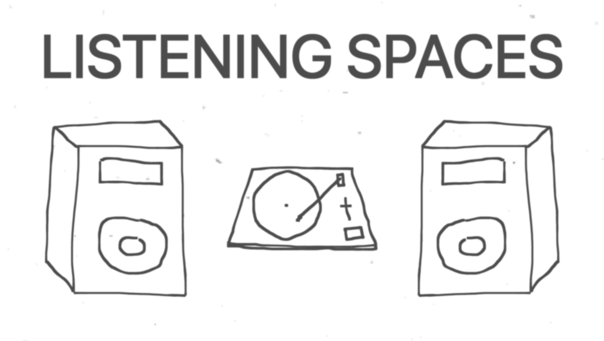

# Listening Spaces



[](https://github.com/jamesbvaughan/listening-spaces/actions/workflows/ci.yaml)

This is a directory of hi-fi listening spaces. Check it out at [listeningspaces.net](https://listeningspaces.net).

## Development

```sh
bun install
bun run dev
```

Formatting is split across two tools, wired together by `bun run format`:

- [oxfmt](https://oxc.rs/docs/guide/usage/formatter) handles data, docs, and CSS.
- [gotmplfmt](https://github.com/gohugoio/gotmplfmt) handles the Hugo templates
  in `layouts/` and `content/*.gotmpl`. oxfmt parses HTML as plain HTML and
  can't read Go template syntax, so those paths are excluded via
  `ignorePatterns` in `.oxfmtrc.json`.

gotmplfmt is not an npm package, so install it separately:

```sh
brew install --cask gohugoio/tap/gotmplfmt
```

## Contributing

If you'd like me to add, update, or remove a listing from the site, or if you
have general feedback or suggestions, please
[email me](mailto:james@jamesbvaughan.com), [file an
issue](https://github.com/jamesbvaughan/listeningspaces.net/issues/new), or send
a PR.
